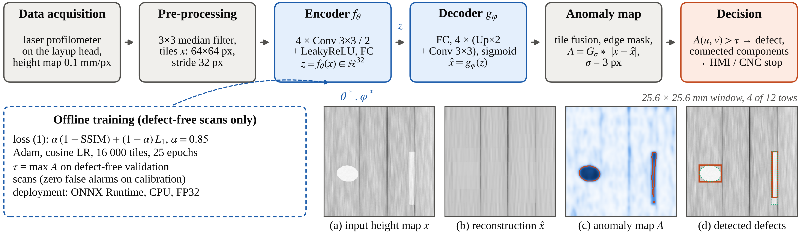

# CAE_DD_AFP: Convolutional Autoencoder for Defect Detection in Automated Fiber Placement

Unsupervised in-process inspection of automated fiber placement (AFP) of polymer composites.
A lightweight convolutional autoencoder (CAE) is trained on defect-free laser-profilometer
height maps only; regions it fails to reconstruct are reported as defects (gaps, overlaps,
twisted and missing tows, wrinkles, fuzzballs, foreign objects).

Source code for the conference abstract
*"Machine Learning Models for Defect Detection: Convolutional Autoencoders for In-Process Inspection
of Automated Fiber Placement"* — V.I. Marinin, R.G. Zaytsev, A.G. Savin, Platov South-Russian State
Polytechnic University (NPI), Novocherkassk, Russia.




## Method

**Input.** 
Height map from a laser profilometer on the layup head, 0.1 mm/px, columns across the
course and rows along the layup direction; a frame is 768 × 256 px (76.8 × 25.6 mm, 12 tows of 6.35 mm).
It is median-filtered (3 × 3) and cut into 64 × 64 tiles with stride 32.

**Model.** 
The encoder $f_\theta$ (four stride-2 3 × 3 convolutions with LeakyReLU and a dense layer)
maps a tile $x \in [0,1]^{64\times 64}$ to a latent code $z = f_\theta(x) \in \mathbb{R}^{32}$; the decoder
$g_\varphi$ (dense layer, four nearest-neighbour ×2 upsampling + 3 × 3 convolution stages, sigmoid) restores
$\hat{x} = g_\varphi(z)$. The parameters minimise the SSIM/L1 loss over $N$ defect-free tiles:

$$
(\theta^*, \varphi^*) = \arg\min_{\theta,\varphi} \frac{1}{N}\sum_{i=1}^{N}
\Big[\alpha\big(1-\mathrm{SSIM}(x_i,\hat{x}_i)\big) + (1-\alpha)\,\lVert x_i-\hat{x}_i\rVert_1\Big],
\qquad \alpha = 0.85. \tag{1}
$$

**Decision rule.** Residuals of overlapping tiles are averaged and smoothed; the outer 1.2 mm of the
course is masked:

$$
A = G_\sigma * |x-\hat{x}|,\qquad D(u,v) = \mathbf{1}\big[A(u,v) > \tau\big],\qquad
\tau = \max_{x\in V_0,\,(u,v)} A(u,v), \tag{2}
$$

where $V_0$ is a set of defect-free validation scans and $\sigma = 3$ px. Connected components of $D$
with area ≥ 0.2 mm² are reported with their bounding boxes in millimetres.

| Layer | Output | Parameters |
|---|---|---|
| input tile | 64 × 64 × 1 | — |
| 4 × Conv 3×3/2 + LeakyReLU (16, 32, 64, 64 ch.) | 4 × 4 × 64 | 60 224 |
| Dense → latent $z$ | 32 | 32 800 |
| Dense + LeakyReLU, reshape | 4 × 4 × 64 | 33 792 |
| 4 × (Up×2 + Conv 3×3 + LeakyReLU) (64, 32, 16, 16 ch.) | 64 × 64 × 16 | 62 336 |
| Conv 3×3 + sigmoid | 64 × 64 × 1 | 145 |
| **Total** | | **189 297 (0.72 MB FP32), 25 MMAC per tile** |

## Results (synthetic data)

Synthetic data emulate laser-profilometer scans of a 12-tow dry carbon-tape course
(`afp_cae/synth.py`: tow steering, crowned cross-sections, fibre texture, sensor noise and dropouts,
seven defect types with pixel-exact masks). See `results/samples.png`.

* Training: 16 000 random tiles from 400 defect-free frames, Adam, cosine LR from 1e-3, batch 64, 25 epochs.
* Threshold: $\tau$ = 0.1081, maximum of $A$ over 100 defect-free validation frames.
* Test: 570 frames (150 defect-free + 60 per defect type) = 14.6 m of course.

| Metric | Value |
|---|---|
| Tile-level AUROC / AP | 0.987 / 0.884 |
| Tile-level precision / recall / F1 at $\tau$ | 0.828 / 0.871 / 0.849 |
| Pixel-level AUROC | 0.977 |
| Defect instances detected | 87.4 % |
| False alarms (components > 3 mm from any defect) | 0.34 per metre (5 in 14.6 m) |
| False alarms on the 150 defect-free test frames | 0 |

| Defect type | gap | overlap | twist | foreign object | fuzzball | wrinkle | missing tow |
|---|---|---|---|---|---|---|---|
| Detected, % | 100 | 100 | 96.7 | 75.0 | 60.0 | 80.0 | 100 |

**Inference** (FP32, CPU only, median of repeated runs; a frame is 161 tiles):

| | Abstract run: Intel Xeon 2.8 GHz, 2 vCPU | Re-run of this repo (`results/*.json`): Intel Xeon 2.1 GHz, 2 vCPU |
|---|---|---|
| ONNX Runtime, 1 tile | 0.83 ms | 0.66 ms |
| ONNX Runtime, 1 frame | 121 ms (1330 tiles/s) | 87 ms (1850 tiles/s) |
| Full pipeline with ONNX Runtime (median filter, tiling, CAE, fusion, threshold, components) | 154 ms → 6.5 frames/s → 10 m/min | 121 ms → 8.2 frames/s → 12.6 m/min |
| JAX/XLA, 1 tile / 1 frame | 1.86 ms / 163 ms | 1.10 ms / 137 ms |

The maximum layup speed is frames/s × 25.6 mm of course per frame. Timings depend on the hardware;
detection metrics are deterministic and are reproduced exactly by `scripts/evaluate.py`.

## Extended experiments (journal article)

The scripts in `experiments/` reproduce the extended results of the journal article (same synthetic data and
evaluation protocol; numbers below are read from `results/article/*.json`).

```bash
python experiments/compare_methods.py        # baselines, map variants, hybrid, thresholds (~6 min)
python experiments/latent_ablation.py        # latent size d = 8, 16, 32, 64 (~35 min)
python experiments/benchmark_inference.py    # batch / threads / stride / stage timing (~3 min, idle machine)
python experiments/make_article_figures.py   # black-and-white figures with Russian labels
# every script accepts --quick for a smoke test
```

**Methods and variants** (test: 570 frames = 14.6 m of course; every method uses its own τ
calibrated on the same 100 defect-free frames; PCA explains 89.1 % of the tile variance):

| Method | Tile AUROC | Pixel AUROC | Detected, % | Mean IoU | False alarms / m |
|---|---|---|---|---|---|
| CAE, σ = 3 px (main) | 0.987 | 0.977 | 87.4 | 0.52 | 0.34 |
| CAE, σ = 1 px | 0.980 | 0.961 | 52.9 | 0.50 | 0.07 |
| CAE, σ = 2 px | 0.987 | 0.971 | 78.8 | 0.51 | 0.41 |
| CAE, σ = 5 px | 0.984 | 0.984 | 85.5 | 0.50 | 0.55 |
| CAE, map (1 − SSIM)/2 | 0.953 | 0.902 | 36.4 | 0.55 | 0.00 |
| CAE, non-overlapping tiles | 0.975 | 0.974 | 63.6 | 0.54 | 0.27 |
| PCA, 32 components | 0.973 | 0.911 | 77.1 | 0.23 | 0.55 |
| Background subtraction along the layup direction (no learning) | 0.940 | 0.774 | 97.9 | 0.37 | 0.00 |
| Hybrid: max(A_CAE/τ_CAE, A_bg/τ_bg) | 0.994 | 0.992 | 97.9 | 0.57 | 0.34 |

A training-free background subtraction along the layup direction finds more defect instances on these synthetic
scans (the simulated tows are homogeneous along the track) but ranks and localises them much worse; the hybrid
keeps the recall of the filter and the ranking quality of the CAE at the same false-alarm rate.

**Threshold operating points** of the main CAE:

| Threshold (main CAE) | τ | Detected, % | False alarms / m | Defect-free frames with an alarm |
|---|---|---|---|---|
| 1.2 τ | 0.1297 | 73.1 | 0.21 | 0 of 150 |
| τ = max over V0 (default) | 0.1081 | 87.4 | 0.34 | 0 of 150 |
| quantile 0.99 | 0.1047 | 89.0 | 0.55 | 0 of 150 |
| quantile 0.95 | 0.1019 | 89.8 | 0.69 | 0 of 150 |
| quantile 0.90 | 0.0989 | 90.2 | 0.96 | 1 of 150 |
| 0.8 τ | 0.0865 | 93.6 | 7.33 | 21 of 150 |

**Latent dimension** (reduced budget: 8000 tiles, 10 epochs; test 50 defect-free + 20 frames per type). A larger
code lowers the training loss but starts to reconstruct defects, so d = 32 gives the best detection:

| d | Parameters | Final loss | Tile AUROC | Detected, % | False alarms / m |
|---|---|---|---|---|---|
| 8 | 140,121 | 0.165 | 0.902 | 28.6 | 0.41 |
| 16 | 156,513 | 0.142 | 0.966 | 42.9 | 0.00 |
| 32 | 189,297 | 0.119 | 0.967 | 57.1 | 0.00 |
| 64 | 254,865 | 0.086 | 0.965 | 37.1 | 0.00 |

**Inference** (Intel(R) Xeon(R) Processor @ 2.10GHz, 2 vCPU, FP32, medians):

| Batch (tiles) | ONNX Runtime, 1 thread, ms | ONNX Runtime, 2 threads, ms | JAX, ms | Tiles/s (ORT, 2 threads) |
|---|---|---|---|---|
| 1 | 0.87 | 0.66 | 1.27 | 1504 |
| 8 | 7.05 | 4.10 | 5.99 | 1952 |
| 32 | 29.00 | 16.15 | 23.18 | 1981 |
| 64 | 58.96 | 31.70 | 48.32 | 2019 |
| 161 | 158.49 | 95.26 | 123.51 | 1690 |

| Stage, ms | Stride 32 (161 tiles) | Stride 64 (48 tiles) |
|---|---|---|
| Median filter 3×3 | 25.8 | 26.3 |
| Tiling | 0.3 | 0.1 |
| CAE (ONNX Runtime, 2 threads) | 92.4 | 23.9 |
| Fusion of overlaps | 3.1 | 1.0 |
| Gaussian smoothing | 4.1 | 4.1 |
| Threshold + connected components | 0.6 | 0.6 |
| **Full frame pipeline** | 135.4 | 61.0 |
| Frames/s → max layup speed | 7.4 → 11.3 m/min | 16.4 → 25.2 m/min |

## Quick start

```bash
git clone https://github.com/rzajtsev/cae_afp.git && cd cae_afp
python -m venv .venv && source .venv/bin/activate        # Windows: .venv\Scripts\activate
pip install -r requirements.txt

python scripts/detect.py --demo --png demo.png          # synthetic frame -> detections
python scripts/evaluate.py                              # reproduce the metrics (~6 min on 2 cores)
python scripts/export_onnx.py                           # ONNX export, parity check, ORT benchmark
python scripts/train.py                                 # retrain from scratch (~45 min on 2 cores)
python scripts/make_figure.py                           # results/fig1.png
python scripts/show_samples.py                          # results/samples.png
```

Tested with Python 3.13, NumPy 2.5, SciPy 1.18, scikit-learn 1.9, JAX 0.11, Optax 0.2.8, ONNX 1.23,
ONNX Runtime 1.29, Matplotlib 3.11. For GPU training install the CUDA build of JAX.

## Using your own scans

Save each height map as a 2-D `.npy` array (0.1 mm/px, rows along the layup direction). Raw heights can be
scaled to [0, 1] with `--normalize` (robust per-scan min-max).

```bash
python scripts/train.py --data scans/train_defect_free --normalize --crops 200 --out models/real.npz
python scripts/calibrate.py --data scans/val_defect_free --normalize --weights models/real.npz
python scripts/detect.py --input scans/new_course.npy --normalize --weights models/real.npz \
                         --json defects.json --png defects.png
```

If the pixel pitch differs from 0.1 mm, resample the scans or adjust `PipelineConfig` in
`afp_cae/pipeline.py` (tile, stride, smoothing, edge band, minimal area).

## Repository layout

```
afp_cae/
  synth.py         synthetic 12-tow AFP height maps with seven defect types
  model.py         CAE in JAX: initialisation, encoder/decoder, SSIM, loss (1), save/load (.npz)
  pipeline.py      pre-processing, tiling, anomaly map, decision rule (2), JAX and ONNX backends
  onnx_export.py   JAX parameters -> ONNX graph (opset 17)
scripts/
  train.py         training (synthetic or --data)
  calibrate.py     threshold calibration on defect-free scans
  evaluate.py      full evaluation protocol + JAX benchmark -> results/results.json, models/threshold.json
  export_onnx.py   ONNX export + ONNX Runtime benchmark -> models/afp_cae.onnx, results/ort_bench.json
  detect.py        detection on one height map (.npy) or a demo frame
  make_figure.py   Figure 1 of the abstract
  show_samples.py  examples of the synthetic defects
experiments/
  common.py                 shared evaluation protocol of the extended experiments
  compare_methods.py        baselines (PCA, background subtraction), map variants, hybrid, threshold sweep
  latent_ablation.py        latent dimension ablation
  benchmark_inference.py    batch / threads / backend / stride / stage timing
  make_article_figures.py   black-and-white figures of the journal article
models/            trained weights (afp_cae.npz), ONNX model, threshold.json
results/           metrics, benchmarks, training log, figures
results/article/   results and figures of the extended experiments
```

## Limitations

* All metrics are obtained on synthetic data with one defect per frame; they are not a substitute for
  validation on real AFP scans.
* The threshold is calibrated for zero false alarms on the validation set; small low-contrast defects
  (fuzzballs, foreign objects) are the main source of misses. A lower quantile in `calibrate.py`
  trades false alarms for recall.
* Defects are localised but not classified by type.
* On the synthetic data a training-free directional background subtraction is a strong baseline at the
  instance level; the hybrid detector (`experiments/compare_methods.py`) is recommended until the CAE is
  validated on real scans.

## Citation

See `CITATION.cff`. Related work by the authors: R.G. Zaytsev, A.R. Zaytseva, "Development directions and
evolutionary characteristics of generative-adversarial networks", *Drukerovskij Vestnik*, 2023, No. 1,
pp. 227–232, doi:10.17213/2312-6469-2023-1-227-232.

## License

Not yet chosen. Add a `LICENSE` file before making the repository public (for example MIT or Apache-2.0,
subject to the university's IP rules); without it the code is "all rights reserved" by default.
